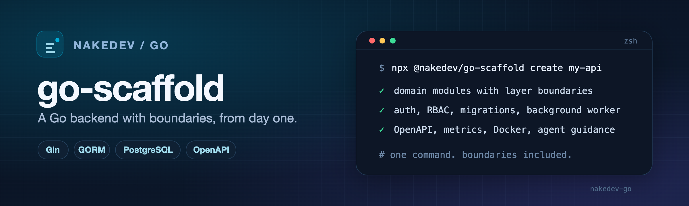
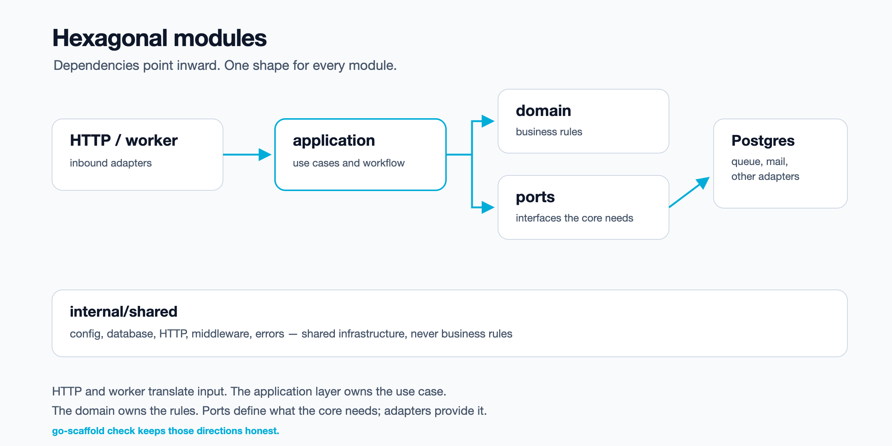

<div align="center">
  
  <h1>go-scaffold</h1>
  <p><strong>A Go backend with boundaries, from day one.</strong></p>
  <p>
    <a href="https://www.npmjs.com/package/@nakedev/go-scaffold"></a>
    <a href="https://nodejs.org"></a>
    <a href="https://github.com/NakePranob/go-scaffold/actions/workflows/ci.yml"></a>
    <a href="LICENSE"></a>
  </p>
</div>

`go-scaffold` is an npm CLI for creating **Gin + GORM + PostgreSQL** backends
with a consistent hexagonal shape. It creates the project, then keeps extending
it with domain modules, endpoints, migrations, auth, RBAC, background jobs, and
observability — without re-deciding the folder structure each time.

## Why go-scaffold

- **Boundaries before business logic.** Every module starts with `domain`,
  `application`, `ports`, and `adapters` in the same places.
- **One shape for every module.** `generate module` and `generate method` write
  the same wiring, tests, and docs every time.
- **The boring wiring is already done.** Auth, RBAC, migrations, background
  jobs, OpenAPI, metrics, and Docker are opt-in commands, not a checklist you
  rebuild by hand.

## Quick start

```bash
npm install --global @nakedev/go-scaffold
go-scaffold create my-api

cd my-api
cp .env.example .env       # optional: edit local settings
make docker-up             # only when create included Docker + PostgreSQL
make db-create
go mod tidy
make run
```

Add the first domain from inside the generated project:

```bash
go-scaffold generate module orders
go-scaffold generate method orders approve --type patch
```

The generated project starts with shared infrastructure and no business
domains. `generate module` adds the domain; `generate method` adds an endpoint
to it.

### Module surfaces

`generate module` keeps the same hexagonal boundary and changes how much code
lives inside it:

- `minimal` (default) — no starter endpoints; add them with `generate method`.
- `read` — a read-only repository port with list/get and no write routes; add
  list endpoints with `generate method`.
- `crud` — list/get/create/update/delete starter routes; writes return 501
  until you implement them.
- `none` — no table, repository, DTOs, or migration.

Use `--plan` to inspect the files and migrations without writing anything:

```bash
go-scaffold generate module reports --surface read --plan
```

### Requirements

- **Node.js >=22.13** for the CLI.
- **Go >=1.25** for the generated project.
- **PostgreSQL** to run the application. Docker is optional.
- `npx @nakedev/go-scaffold ...` works if you do not want a global install.

## What you get

| Area | What `go-scaffold` gives you |
| --- | --- |
| **Architecture** | Domain modules with `domain`, `application`, `ports`, and `adapters`; a `check` command that enforces the layer rules. [See the proof](#proof-it-catches-a-violation). |
| **Auth** | Email/password and provider auth, sessions, refresh rotation, MFA, recovery codes, and ASVS-oriented security defaults. |
| **RBAC** | Roles and permissions with generated authorization middleware. |
| **Data** | Timestamped migration pairs, GORM models, repositories, and a migration verification workflow. |
| **Background jobs** | River (PostgreSQL) or Asynq (Redis) queues, mail delivery, and `cmd/worker`. |
| **Operations** | OpenAPI docs, Prometheus metrics, OpenTelemetry tracing, Docker Compose, and health endpoints. |
| **Agent guidance** | `AGENTS.md`, `CLAUDE.md`, and one repository-wide skill under `.agents/skills/go-scaffold/`. |

## CLI or manual setup?

| Situation | Choose | Why |
| --- | --- | --- |
| One-off project, or the architecture is the experiment | Manual | You keep full control of every file and convention. |
| More than one repository, or the same feature is repeated | CLI | The next project starts with the same shape. |
| More than one person or agent edits the repo | CLI | Boundary checks and agent guidance ship with the scaffold. |
| You need to prove an import is rejected | CLI | ESLint/Steiger or `check` is already wired. |
| Every file must be custom | Manual | The CLI is opinionated by design. |

A manual setup gives you the most freedom. It is the right choice when the architecture is intentionally different, the project is a one-off, or you need to own every file from the first commit. The cost is that every convention — layer boundaries, auth wiring, framework path rules — has to be rebuilt and reviewed again.

The CLI is for repetition. It gives the next project the same shape, encodes framework and layout constraints, and ships boundary checks and agent guidance with the scaffold. It is not automatically faster; a fair cross-project benchmark has not been run.

Use the CLI when repeatability, reviewable boundaries, and a stable target for AI agents matter. Use a manual setup when the architecture itself is the experiment.

## HTTP contract presets

Each project picks one response contract at create time. The built-in presets
are `default` (current wire format), `envelope` (`data`/`meta`), `items`
(`items`/`total` plus an errors array), and `problem` (RFC 7807 errors).
Company presets are JSON files under `presets/`:

```bash
go-scaffold create acme-api --http-preset acme-v1 --preset-dir ./presets
```

The resolved shapes are frozen in `go-scaffold.config.json`, so a later preset
change does not silently alter an existing project. Non-default presets are
Go-side only for now: the generated Next.js/SvelteKit clients still assume the
default shapes, and `create --plan` warns about that combination.

## How it fits together



The HTTP adapter translates requests. The application layer owns the use case.
The domain owns the rules. Ports define what the application needs. Adapters
provide PostgreSQL, queues, mail, or other infrastructure. `go-scaffold check`
keeps those directions honest.

## Proof it catches a violation

`application` is the use-case layer; it must not know which database or queue implementation is used. Importing an outbound adapter couples business logic to infrastructure, makes tests require the adapter, and can create circular dependencies.

After `generate module orders`, this compiles but points the wrong way:

```go
// internal/app/order/application/illegal.go
package application

import _ "example.com/app/internal/app/order/adapters/outbound/postgres"
```

```bash
go build ./...
# exit 0 — it compiles, but the architecture is still wrong

go-scaffold check
# exit 1
# application layer imports forbidden internal layer
# internal/app/order/application/illegal.go
```

Remove the illegal import:

```bash
go-scaffold check
# exit 0
# architecture check passed: 1 split module(s), hexagonal boundary
```

**What this catches:** application → outbound adapter imports, domain → application/adapter imports, private composition imports, and transport DTO leakage. **What it does not catch:** runtime dependency injection, transaction boundaries, and behavior inside an adapter.

## Same input, same output

Measured pilot, not yet a CI gate: three independent runs with the same CLI version and flags. Migration filenames are timestamped, so `YYYYMMDDHHMMSS_` is normalized to `<timestamp>_` before hashing.

- 55 files in each run
- manifest `7c8a6acf…`
- A↔B diff: 0
- A↔C diff: 0
- editing one generated file produced an 11-line manifest diff

The manifest is every generated file's relative path plus its SHA-256, excluding `.git`.

## Generated project

```text
my-api/
├─ cmd/api/                  # HTTP entrypoint
├─ cmd/worker/               # added by `add worker`
├─ internal/
│  ├─ app/<module>/          # domain, application, ports, adapters
│  └─ shared/                # config, database, HTTP, middleware, errors
├─ migrations/               # timestamped SQL pairs
├─ docs/architect/           # generated architecture notes
├─ AGENTS.md
├─ CLAUDE.md
└─ go-scaffold.config.json   # the generated-project contract
```

## Commands

| Command | What it does |
| --- | --- |
| `create [name]` | Create a new Go backend project. |
| `check` | Validate the hexagonal layout and layer dependencies. |
| `generate module [name]` | Add a domain module. Alias: `g m`. |
| `generate method [module] [name]` | Add one endpoint to an existing module. Alias: `g me`. |
| `generate migration [name]` | Reserve a timestamped SQL migration pair. Alias: `g mig`. |
| `config` | Set defaults for future modules. |
| `add worker` | Add background jobs, mail, and `cmd/worker`. |
| `add auth` | Add email/password and provider authentication. |
| `add rbac` | Add roles, permissions, and authorization middleware. |
| `add observability` | Add Prometheus metrics and OpenTelemetry tracing. |
| `undo module [name]` | Remove a generated module and its wiring. |

Run any command with `--help` for its current options. The full command
reference — wizard behavior, every option, generated output, and architecture
notes — lives in [`REFERENCE.md`](REFERENCE.md).

## Agent guidance

`create` writes agent guidance once per repository, not once per package:

- `AGENTS.md` and `CLAUDE.md` inside each generated package;
- `.agents/skills/go-scaffold/SKILL.md` at the repository root;
- `.claude/skills/go-scaffold` as a symlink to the `.agents` copy.

The skill tells an agent to locate the target package's
`go-scaffold.config.json`, `AGENTS.md`, and `docs/architect/` before acting. If
a skill with different content already exists, `create` reports it and leaves
it untouched.

## Auth: beta

`add auth` generates email/password and provider auth, sessions and refresh rotation, MFA and recovery codes, login throttling, browser-origin checks, and RBAC hooks. It is beta: these flows have unit/integration coverage, not a production security audit.

**What you still own:** HTTPS and trusted proxy, secret management and rotation, provider credentials, mail delivery, recovery/helpdesk policy, and server-side authorization tests. Existing projects need the `last_totp_step` migration.

## What this does not cover

- Runtime behavior against your production PostgreSQL/Redis
- Worker retry, idempotency, and mail failure handling
- A full security audit
- Every possible architecture rule; `check` is a static direct-import check

## Learn more

- [Full command reference](REFERENCE.md)
- [Auth security checklist](docs/auth-security-checklist.md)
- [Source, template, and test workflow](AGENTS.md)
- [Contributing guide](CONTRIBUTING.md)

## Development

```bash
pnpm install --frozen-lockfile
pnpm run build
pnpm run verify
node bin/go-scaffold.js create my-api --defaults
```

`pnpm run verify` builds the CLI, runs unit and integration tests, and runs the
generated-project smoke suite. See [`AGENTS.md`](AGENTS.md) for the release
contract and the source/template/test workflow.

## License

MIT — see [LICENSE](LICENSE).
